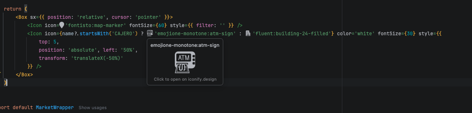

# Iconify Icon Preview

JetBrains IDE plugin that draws [Iconify](https://iconify.design) icons next to their names in the editor, e.g.
`<Icon icon="emojione-monotone:atm-sign" />`.



- Inline preview in the editor's text color, in any file type.
- Hover for a 64 px preview, click to open the icon on iconify.design.
- Completion with pictures: `"mdi:` lists a set's icons; in `icon="…"` properties a plain word searches all sets.
- "Unknown Iconify icon" inspection: misspelled names are underlined, with quick fixes to the closest real icons.
- Only prefixes of real Iconify sets are previewed (the list comes from `/collections` and is refreshed weekly).
- Icons are downloaded once from the Iconify API and cached in `<IDE system dir>/iconify-preview/`.

## Build and install

```bash
./gradlew test buildPlugin     # → build/distributions/iconify-preview-<version>.zip
./gradlew verifyPlugin         # Plugin Verifier against 2025.2 and the latest release
./gradlew runIde               # sandbox IDE with the plugin loaded
```

Install the zip with *Settings → Plugins → ⚙ → Install Plugin from Disk…*. No restart needed.

## Release

The first version was uploaded by hand on plugins.jetbrains.com (`publishPlugin` only updates existing plugins). After
that, `.github/workflows/release.yml` publishes: bump `version` in `build.gradle.kts`, add a `<h3>version</h3>` entry to
`<change-notes>` in `plugin.xml`, push, wait for CI, then `git tag v<version> && git push origin v<version>`. It needs the
repository secret `PUBLISH_TOKEN` (Marketplace → Profile → My Tokens; never commit it). JetBrains reviews each version
before it goes public.

## Privacy

No telemetry. Only icon names are sent to the Iconify API; see [PRIVACY.md](PRIVACY.md).

## Structure

| File | Role |
| --- | --- |
| `IconNameScanner.kt` | Finds quoted `prefix:name` strings (no IntelliJ dependencies) |
| `IconifyClient.kt` | Collection list, icon sets, search, SVG download, disk cache, coloring; publishes `TOPIC` / `SETS_TOPIC` |
| `IconSet.kt` | Parses a set's names (`/collection`): visible ones for completion, all (hidden, aliases) for validation |
| `IconTyping.kt` | What is being typed in a string, icon property detection, completion matching (no IntelliJ dependencies) |
| `IconCompletion.kt` | Completion contributor, auto-popup on `:`, completion inside strings, `-`/`:` kept in the lookup |
| `UnknownIconInspection.kt` | "Unknown Iconify icon" inspection and its "Replace with …" quick fixes |
| `IconSuggestions.kt` | Closest names for misspelled icons (edit distance with swaps) |
| `EditorIconPreview.kt` | Per editor: inlays, hover popup, click to open, refresh on edit/theme/load |
| `IconInlayRenderer.kt` | Paints the icon scaled to the line height |
| `Listeners.kt` | Attaches previews to editors (also after a dynamic install) |
| `IconifyPreviewSettings.kt` / `IconifyPreviewConfigurable.kt` | *Settings → Tools → Iconify Icon Preview* |

User-facing texts live in `messages/IconifyPreviewBundle.properties` (English) and `_es.properties` (Spanish), with the
same keys.
